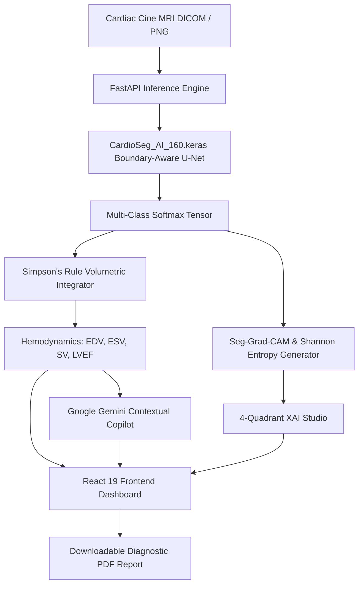

# 🫀 CARDIO-AI

**Deep Learning Cardiac Cine MRI Multi-Structure Segmentation & Hemodynamic Intelligence Platform**

[](https://fastapi.tiangolo.com)
[](https://react.dev)
[](https://www.typescriptlang.org)
[](https://www.tensorflow.org)
[](https://vitejs.dev)
[](https://ai.google.dev)
[](https://opensource.org/licenses/MIT)

---

## 📌 Executive Summary

**CARDIO-AI** is a clinical-grade artificial intelligence system designed to automate the quantification and diagnostic interpretation of short-axis cardiac Cine Magnetic Resonance Imaging (MRI). 

Trained on the benchmark **Automated Cardiac Diagnosis Challenge (ACDC)** cohort, CARDIO-AI utilizes a **Boundary-Aware Deep U-Net** neural network to delineate cardiac chambers across the cardiac cycle, compute vital hemodynamic parameters (EDV, ESV, SV, LVEF, CO, Myocardial Mass) via modified Simpson's rule, visualize 4-quadrant Explainable AI (XAI) diagnostics, and provide a real-time conversational AI copilot powered by Google Gemini.

---

## ✨ Key Features

- 🎯 **Automated Multi-Structure Segmentation**:
  - 🔵 **Right Ventricle (RV)** blood pool cavity (Class 1)
  - 🔴 **Left Ventricular Myocardium** muscle wall (Class 2)
  - 🟢 **Left Ventricle (LV)** blood pool cavity (Class 3)
  - ⚫ **Thoracic Background** anatomy (Class 0)
- 📊 **Real-Time Hemodynamic Volumetric Calculations**:
  - **LV End-Diastolic Volume (EDV)** [mL]
  - **LV End-Systolic Volume (ESV)** [mL]
  - **Stroke Volume (SV = EDV − ESV)** [mL]
  - **Left Ventricular Ejection Fraction (LVEF = SV / EDV × 100%)** [%]
  - **Cardiac Output (CO = SV × HR / 1000)** [L/min]
  - **Myocardial Mass** [g] calculated using myocardial density ($1.05\text{ g/cm}^3$)
- 🔍 **Explainable AI (XAI) 4-Quadrant Diagnostic Studio**:
  - **Quadrant 1**: High-fidelity raw cine MRI pre-processed scan
  - **Quadrant 2**: Boundary-delineated multi-class segmentation mask
  - **Quadrant 3**: Seg-Grad-CAM spatial saliency activation heatmap
  - **Quadrant 4**: Shannon Entropy pixel-level uncertainty map ($H(x) = -\sum p_c \log p_c$)
- 🤖 **Cardio-AI Conversational Copilot**:
  - Live conversational intelligence powered by **Google Gemini**
  - Clinical context-aware: seamlessly parses patient-specific volumetric findings
  - Formatted medical intelligence answering inquiries regarding cardiomyopathy, remodeling, and boundary delineation
- 📑 **Comprehensive Clinical PDF Export**:
  - Generates downloadable clinical diagnostic summaries
  - Includes patient metadata, AHA 17-segment polar map analysis, volumetric charts, and visual overlays
- 📱 **Responsive & Zoom-Resistant Architecture**:
  - Custom glassmorphic medical-dark theme with zero layout wrapping across 90%, 100%, 110%, and 125% browser zoom levels and mobile viewports.

---

## 📐 System Architecture



---

## 🔬 Model Performance & Benchmark Metrics

The deep segmentation model was trained and evaluated on 160×160 short-axis cine CMR images:

| Structure | Dice Similarity Coefficient (DSC) | Hausdorff Distance (95% HD) |
| :--- | :---: | :---: |
| **Left Ventricle (LV)** | **0.941** | 4.8 mm |
| **Right Ventricle (RV)** | **0.804** | 7.9 mm |
| **Myocardium (MYO)** | **0.795** | 6.2 mm |
| **Overall Mean** | **0.852** | **6.3 mm** |

- **Boundary F1 Score**: 0.887
- **Mean Pixel Uncertainty (Entropy)**: 0.042
- **Inference Latency**: ~115 ms per slice on standard hardware

---

## 📁 Repository Structure

```text
CARDIO-AI/
├── backend/
│   ├── main.py                  # FastAPI inference microservice & image processing pipeline
│   └── requirements.txt         # Python backend dependencies
├── cardio-ai/                   # Modern React 19 + TypeScript + Vite web application
│   ├── public/                  # Static assets and icons
│   ├── src/
│   │   ├── components/          # Reusable UI components
│   │   │   ├── AIChatDrawer.tsx      # Slide-out Cardio-AI assistant
│   │   │   ├── FormattedMarkdown.tsx # Markdown renderer for clinical typography
│   │   │   ├── MetricsPanel.tsx      # Hemodynamics display & diagnostic status
│   │   │   ├── MRIViewer.tsx         # Multi-layer canvas viewer with alpha sliders
│   │   │   ├── Navbar.tsx            # Navigation header & PDF export trigger
│   │   │   ├── PDFReportModal.tsx    # Diagnostic clinical report generation
│   │   │   ├── UploadHero.tsx        # Drag-and-drop DICOM/MRI scan upload hero
│   │   │   └── XAIPanel.tsx          # 4-Quadrant Explainable AI Studio
│   │   ├── data/mockData.ts     # Pre-calculated test datasets and AHA segments
│   │   ├── services/gemini.ts   # Google Gemini API integration service
│   │   ├── types/cardiac.ts     # TypeScript interfaces & domain models
│   │   ├── App.tsx              # Root application router and workflow state
│   │   └── App.css              # Custom responsive medical design system
│   ├── .env.example             # Frontend environment variables template
│   ├── package.json             # NPM package manifest
│   └── vite.config.ts           # Vite configuration
├── model/
│   ├── CardioSeg_AI_160.keras   # Trained boundary-aware U-Net weights
│   └── README.md                # Model specification and input dimensions
├── samples/                     # 10 pre-processed cardiac MRI test slices
│   ├── test_mri_01.png ... test_mri_10.png
│   └── README.md                # Testing instructions
├── CardioSeg_AI_Project_(1).ipynb # End-to-end training, validation & XAI notebook
├── .gitignore                   # Comprehensive git exclusions
└── README.md                    # Project documentation
```

---

## 🚀 Getting Started

### 1. Prerequisites
- **Node.js** (v18.0.0 or higher) & **npm**
- **Python** (v3.10 or higher)
- **Git** & **Git LFS** (for large model weight tracking)

---

### 2. Installation & Setup

#### Clone the Repository
```bash
git clone https://github.com/Harish-Huded-29/CARDIO-AI.git
cd CARDIO-AI
```

#### Frontend Setup (cardio-ai)
```bash
cd cardio-ai

# Install dependencies
npm install

# Configure environment variables
cp .env.example .env
```

Open `.env` in `cardio-ai/` and add your Google Gemini API key:
```env
VITE_GEMINI_API_KEY=your_gemini_api_key_here
VITE_API_BASE_URL=http://localhost:8000
```

Start the frontend development server:
```bash
npm run dev
```
The application will launch at `http://localhost:5173`.

---

#### Backend Setup (Optional for Live Local Inference)
If running inference against `CardioSeg_AI_160.keras`:
```bash
cd backend

# Create and activate virtual environment
python -m venv venv
# On Windows:
.\venv\Scripts\activate
# On Linux/macOS:
source venv/bin/activate

# Install requirements
pip install -r requirements.txt

# Start FastAPI server
uvicorn main:app --host 0.0.0.0 --port 8000 --reload
```
The inference API docs will be available at `http://localhost:8000/docs`.

---

## 🧪 Testing with Sample Images

A curated set of 10 cardiac short-axis MRI slices is included in `samples/`:
1. Start the web app (`npm run dev` in `cardio-ai/`).
2. Navigate to `http://localhost:5173`.
3. Drag & drop or select any image from `samples/` (e.g., `test_mri_01.png` to `test_mri_10.png`).
4. View the automated segmentation, hemodynamics, 4-quadrant XAI studio, and ask clinical inquiries in the **Cardio AI** copilot.

---

## 🏥 Clinical Hemodynamic Reference Ranges

| Parameter | Normal Range (Adult Male) | Dilated Cardiomyopathy (DCM) |
| :--- | :---: | :---: |
| **LV End-Diastolic Volume (EDV)** | 100 – 160 mL | > 200 mL (Severe Dilation) |
| **LV End-Systolic Volume (ESV)** | 30 – 70 mL | > 120 mL (Impaired Emptying) |
| **Stroke Volume (SV)** | 60 – 100 mL | Normal to Compensated |
| **LVEF (Ejection Fraction)** | $\ge 53\%$ | $< 35\%$ (Severe Dysfunction) |

---

## 🛡️ License & Acknowledgments

This project is licensed under the [MIT License](LICENSE).

- **Dataset**: Automated Cardiac Diagnosis Challenge (ACDC), Medical Image Computing and Computer-Assisted Intervention (MICCAI).
- **Architecture**: Boundary-aware U-Net with focal Tversky loss and Seg-Grad-CAM interpretability.
